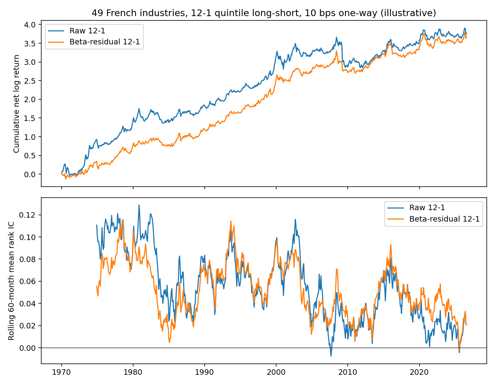

# Residual momentum, done so a quant can check it

Two separate pieces that answer different questions. Neither is a live track record.

1. **Real data.** 12–1 momentum on Kenneth French's 49 value-weighted industry portfolios, with a beta the researcher could have estimated at the time.
2. **Simulation.** A power and false-keep study of a pre-committed keep/reject rule, under a data-generating process where size contaminates the raw score, with the contamination level varied.

## What was wrong with a single-seed demo

A planted panel plus one seed can show "residual clears the cost hurdle, raw does not" by luck. Across seeds that gap disappears when beta, size and industry barely move the 12–1 score. This repo does not make that claim from one seed.

## Real-data design

Source files in `data/` come from [Ken French's data library](https://mba.tuck.dartmouth.edu/pages/faculty/ken.french/data_library.html) (CRSP vintage 202608; © Fama and French, see the library's terms):

- `49_Industry_Portfolios.csv`: monthly value-weighted returns
- `F-F_Research_Data_Factors.csv`: Mkt-RF and RF

Rules, all lagged:

- Sample: January 1970 to August 2026 (680 months). All 49 industries have under 5% missing months in that window.
- **Signal for holding month t** is the compounded return from **t−12 through t−2**. Month t−1 is skipped once (short-term reversal). The book earns month t. It does not skip a second month.
- **Beta** is a 36-month OLS of excess return on Mkt-RF using months **through t−1** only (at least 24 months). No population beta.
- Residual book: each month, cross-sectional OLS of the 12–1 score on that estimated beta.
- Portfolio: equal-weight quintile long–short. Cost is one-way turnover × 10 bps. These are **industry portfolios**, not a stock book. The cost is illustrative. This is not a tradable strategy.
- Uncertainty: Newey–West t-stat on monthly rank IC (4 lags); 2,000-draw bootstrap CI for mean IC; Sharpe SE from the Lo (2002) iid approximation; and, because the two books are 0.8+ correlated, a **paired** 12-month block bootstrap for the Sharpe difference and a Newey–West t-stat on the IC difference. Two books were pre-committed. This is not a factor search.

### Result (`results/REPORT.txt`)

| Book | Mean rank IC | NW t | Bootstrap 95% CI | Net Sharpe (SE) |
|---|---|---|---|---|
| Raw 12–1 | 0.054 | 4.87 | [0.032, 0.078] | 0.48 (0.13) |
| Beta-residual 12–1 | 0.050 | 5.42 | [0.032, 0.068] | 0.55 (0.13) |

**Paired comparison (residual − raw).** Net-return correlation 0.82, IC correlation 0.84. IC difference −0.004 (NW t = −0.64). Net Sharpe difference +0.066, paired block-bootstrap 95% CI [−0.099, +0.220]. **On this cross-section, beta-neutralizing 12–1 does not produce a reliably different book.**

**The edge is not stable across the sample.** Fixed split, chosen before looking, descriptive only:

| Period | Raw IC (NW t) | Raw net Sharpe | Residual IC (NW t) | Residual net Sharpe |
|---|---|---|---|---|
| 1970–1999 | 0.078 (4.7) | 0.76 | 0.064 (4.8) | 0.73 |
| 2000–2026 | 0.028 (2.0) | 0.23 | 0.034 (2.8) | 0.38 |
| 2010–2026 | 0.033 (2.1) | 0.42 | 0.041 (2.8) | 0.47 |

Post-2000, both books are below the 0.40 Sharpe bar used in the simulation rule. Industry momentum itself is a known result (Moskowitz and Grinblatt, 1999); the neutralization test is the part this repo adds.



Industry portfolios are diversified, so these ICs are larger than a stock-level IC. Do not copy 0.05 onto a single-name resume bullet.

## Simulation: power of the rule

`ortho/simulate.py`. 80 names, 8 industries, 240 months, 200 seeds, 12 bps one-way. The researcher residualizes on a **36-month estimated** beta (market proxy = cross-sectional mean) and on observable size, then industry-demeans. The true beta is not an input.

Keep rule, fixed before looking at a seed: |IC t| ≥ 2 and net Sharpe ≥ 0.40.

The contamination dial is `size_vol`, the monthly vol of the size factor. Realized SMB vol is about 3.0% a month (1970–2026, computed from the bundled factor file). The original run used 7%, which is deliberately heavy.

Share of seeds kept (raw / residual):

| Latent signal | size_vol 1% | size_vol 3% (≈ SMB) | size_vol 7% (heavy) |
|---|---|---|---|
| 0 (noise) | 1.5% / 1.5% | 2.5% / 1.0% | 4.5% / 1.5% |
| 25 | 16.0% / 13.5% | 9.0% / 12.0% | 4.5% / 10.5% |
| 50 | 76.5% / 84.0% | 59.5% / 82.5% | 15.5% / 73.5% |
| 75 | 100% / 100% | 99.0% / 100% | 45.5% / 100% |

Read it as operating characteristics, not performance:

- The rule false-keeps noise at most 4.5% of the time for either book.
- The residual book's advantage over raw grows with contamination. At 1% it is small; at SMB-like 3% it is real at mid signal (82.5% vs 59.5%); at 7% it is large.
- The result depends on the contamination level, which is why it is a table and not a number. Size also loads as exactly −`size_z`, and `size_z` is what the researcher residualizes on, so size is the easy case by construction.
- With 16 years of months the Sharpe cutoff is still noisy (SE about 0.25).

The real-data test neutralizes only beta, and industry portfolios have no size dimension, so it does not contradict the simulation. It shows that beta-neutralizing industry momentum changes little.

## Run

```bash
pip install -r requirements.txt
python scripts/run_all.py          # full run, ~10 minutes on one core
python scripts/run_all.py --quick  # 40 seeds, smoke test, does not overwrite results/
pytest -q tests                    # window/lag, no-lookahead, and metric checks
```

## Results

- Ken French 49 industries, 1970–2026: built a lagged 12–1 momentum test with rolling estimated betas and Newey–West/bootstrap inference; raw and beta-residual rank ICs were both about 0.05 (NW t > 4) with no reliable difference (paired Sharpe-gap 95% CI [−0.10, 0.22]), and the edge weakened after 2000 (net Sharpe 0.23 raw, 0.38 residual).
- Simulation harness for a pre-committed keep/reject rule (200 seeds): false-keep rate at most 4.5% under no signal; at a mid planted signal, residual-momentum power 82.5% vs 59.5% for raw at realistic size-factor vol, widening to 73.5% vs 15.5% under heavy contamination.

## Future Improvements

- Not stock-level CRSP. Survivorship-free single names are the next step; yfinance on today's S&P 500 is the wrong substitute unless survivorship bias is stated in the first sentence.
- Not a search over horizons, skip months, or factor sets. Adding those without a multiple-testing note would make the t-stats meaningless.
- Costs are illustrative and the books are portfolios of industries, not a capacity-tested strategy.
